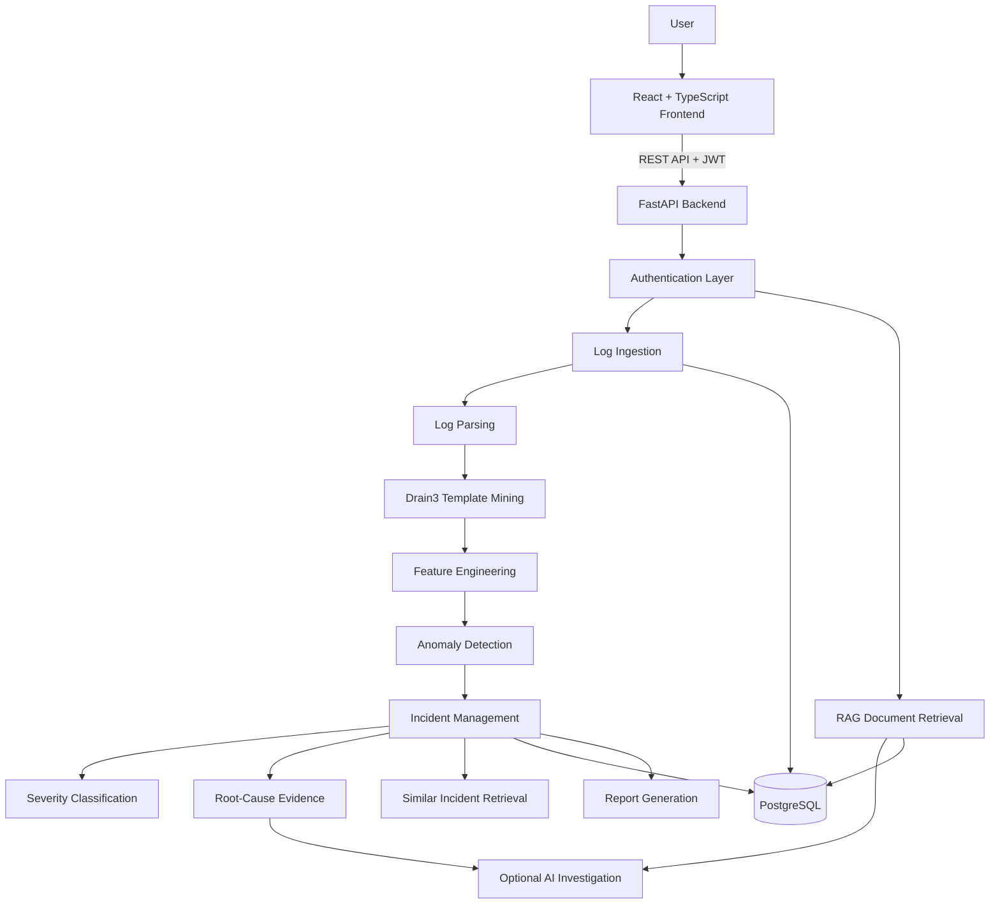

<div align="center">

# 🛰️ IntelliOps AI

### AI-Powered Log Analysis and Incident Investigation Platform

**Turn raw application logs into structured, explainable incident investigations.**

Machine Learning · Root-Cause Evidence · RAG Runbook Assistant · Optional AI Investigation

<br>

[](https://www.python.org/)
[](https://fastapi.tiangolo.com/)
[](https://react.dev/)
[](https://www.postgresql.org/)
[](https://scikit-learn.org/)
[](https://www.docker.com/)

[](#verification-and-evidence)
[](#verification-and-evidence)
[](#verification-and-evidence)
[](LICENSE)

<br>

[🌐 Portfolio Preview](https://manishyadav-aiml.github.io/IntelliOps-AI/)
· [📸 Screenshots](#screenshots)
· [🏗️ Architecture](#system-architecture)
· [🚀 Quick Start](#getting-started)
· [🧪 Testing](#verification-and-evidence)
· [🔐 Security](#security)

</div>

---

## 📌 Overview

During a production failure, engineers often need to investigate thousands of application log lines to identify unusual patterns, determine incident severity, locate affected services, compare historical incidents, and search technical documentation.

This process can be time-consuming and difficult to manage manually.

**IntelliOps AI** is an AI-powered log analysis and incident investigation platform designed to streamline this workflow.

It combines log processing, machine learning, incident management, explainable root-cause evidence, similar-incident retrieval, and Retrieval-Augmented Generation (RAG) into one application.

### What IntelliOps AI does

- Automatically parses application logs and extracts recurring templates.
- Detects anomalous log patterns using unsupervised machine learning.
- Groups anomalous time windows into structured incidents.
- Assigns explainable P1–P4 incident severity levels.
- Identifies potential root-cause evidence across affected services.
- Retrieves similar historical incidents.
- Answers operational questions using uploaded runbooks and technical documents.
- Generates incident reports in PDF, CSV, and JSON formats.
- Provides optional AI-assisted incident investigation.

> **Important:** IntelliOps AI identifies anomalies and potential root causes. An AI-generated suggestion is never considered a confirmed root cause. Human engineers remain responsible for reviewing and confirming findings.

### 🚀 Demo Status

| Component | Status |
|---|---|
| GitHub Pages Preview | Available |
| Full-Stack Application | Runs Locally |
| FastAPI Backend | Available Locally |
| React Frontend | Available Locally |
| PostgreSQL Integration | Available Locally |
| Machine Learning Pipeline | Implemented |
| RAG Runbook Assistant | Implemented |
| Optional Gemini Integration | Implemented; live provider integration not independently verified |
| Public Full-Stack Deployment | Not Available |
| Video Demonstration | To Be Added |

**Important distinction:**

The [GitHub Pages preview](https://manishyadav-aiml.github.io/IntelliOps-AI/) is a static frontend portfolio demonstration containing illustrative sample data.

It is not connected to the FastAPI backend, PostgreSQL database, authentication system, or live AI/ML services.

Screenshots and dashboard figures such as 24,850 log events and 98.2% are illustrative examples, not measured production results.

The full-stack application can be executed locally using the instructions in this README.

---

## 📸 Screenshots

> Screenshots captured from the static portfolio preview on 16 November 2026. All displayed metrics are illustrative.

<table>
  <tr>
    <td width="50%">
      
      <br>
      <sub><b>Overview Dashboard</b> — Application metrics, log volume, and anomaly trends.</sub>
    </td>
    <td width="50%">
      
      <br>
      <sub><b>Log Management</b> — Search and filter events by service and severity.</sub>
    </td>
  </tr>
  <tr>
    <td width="50%">
      
      <br>
      <sub><b>Anomaly Detection</b> — Scored anomaly records with P1–P4 severity.</sub>
    </td>
    <td width="50%">
      
      <br>
      <sub><b>Incident Management</b> — Incident register with severity and lifecycle status.</sub>
    </td>
  </tr>
  <tr>
    <td width="50%">
      
      <br>
      <sub><b>Document Library</b> — Runbooks and technical documentation.</sub>
    </td>
    <td width="50%">
      
      <br>
      <sub><b>AI Assistant</b> — Suggested operational investigation scenarios.</sub>
    </td>
  </tr>
</table>

---

## 🎯 Problem Statement

Application failures generate large volumes of logs, making incident investigation difficult and time-consuming.

Engineers typically need to:

1. Search through large volumes of application logs.
2. Identify unusual patterns and recurring errors.
3. Determine which services are affected.
4. Understand when an error first appeared.
5. Assign an appropriate incident severity.
6. Investigate possible root causes.
7. Compare the current incident with historical incidents.
8. Search technical documentation and operational runbooks.
9. Prepare incident investigation reports.

Performing these activities manually can delay incident resolution.

**IntelliOps AI addresses this problem by combining automated log analysis, anomaly detection, incident investigation, and evidence-based documentation retrieval in one platform.**

---

## ✨ Key Features

| Feature Area | Capabilities |
|---|---|
| **Log Management** | Log upload, validation, parsing, filtering, and processing |
| **Log Parsing** | ISO, HDFS, syslog, bracketed, CSV, and custom-regex formats |
| **Template Extraction** | Drain3 template mining with regex fallback |
| **Anomaly Detection** | Isolation Forest, Local Outlier Factor, and statistical baseline |
| **Incident Grouping** | Automatic incident creation and duplicate prevention |
| **Severity Classification** | Explainable P1 Critical, P2 High, P3 Medium, and P4 Low |
| **Root-Cause Evidence** | Earliest failing service, new error templates, error-rate changes |
| **Similar Incident Retrieval** | Embedding-based retrieval using FAISS or exact NumPy search |
| **AI Investigation** | Optional Gemini-powered evidence-grounded investigation |
| **RAG Assistant** | Document retrieval, contextual answers, and source citations |
| **Incident Lifecycle** | OPEN → INVESTIGATING → MITIGATED → RESOLVED |
| **Reporting** | PDF, CSV, and JSON incident reports |
| **Audit Logging** | Tracking important application activities |
| **Authentication** | JWT-based authentication and per-user data isolation |

---

## 🏗️ System Architecture

IntelliOps AI follows a modular full-stack architecture.

### High-Level Architecture



### Processing Workflow

```text
Log Upload
    ↓
Input Validation
    ↓
Log Parsing
    ↓
Template Mining
    ↓
Feature Engineering
    ↓
Anomaly Detection
    ↓
Incident Grouping
    ↓
Severity Classification
    ↓
Root-Cause Evidence
    ↓
Optional AI Investigation
    ↓
Incident Report Generation
```

### Architecture Principles

- Modular backend architecture.
- Separation of API, business logic, and machine learning components.
- Authenticated API requests.
- Per-user data isolation.
- Evidence-based investigation.
- Optional AI integration.
- Database-backed application persistence.
- Independently testable algorithm modules.

Algorithms are organized into dependency-light modules such as `parsers/`, `ml/`, `rag/`, and `ai/`.

For additional details, see [System Architecture](docs/SYSTEM_ARCHITECTURE.md).

---

## 🧠 Machine Learning Pipeline

The machine learning pipeline analyzes application log patterns and identifies unusual behavior.

### 1. Feature Engineering

Log events are aggregated into time windows and converted into numerical features.

Features include:

- Total log events.
- Error-level counts.
- Warning-level counts.
- Log-level ratios.
- Service-level event volume.
- Number of unique templates.
- Repeated template frequency.
- Changes in error frequency.
- Time intervals between errors.

A temporal causality test verifies that future information does not influence earlier feature rows.

### 2. Anomaly Detection Algorithms

| Algorithm | Purpose |
|---|---|
| Robust Statistical Baseline | Fallback detector when no trained model is available |
| **Isolation Forest** | Primary unsupervised anomaly detection model |
| Local Outlier Factor | Comparison anomaly detection model |

### 3. Model Evaluation

The evaluation pipeline measures:

- Precision
- Recall
- F1-score
- PR-AUC
- False-positive rate
- Confusion matrix

A leakage-aware evaluation split is used. For the HDFS dataset, the intended split strategy groups records by block ID.

### Synthetic Evaluation Results

The following results were obtained from generated synthetic data.

| Metric | Isolation Forest | Local Outlier Factor |
|---|---:|---:|
| Precision | 0.759 | 0.486 |
| Recall | 0.846 | 0.692 |
| F1-score | 0.800 | 0.571 |
| False-Positive Rate | 0.012 | 0.033 |
| PR-AUC | 0.823 | 0.730 |

**Evaluation command:**

```bash
python scripts/evaluate_models.py --mode synthetic
```

**Evaluation disclaimer:**

These results validate the evaluation pipeline using generated synthetic data.

They do not establish real-world detection accuracy or production performance.

Evaluation on the LogHub/HDFS dataset remains outstanding.

### Documented Model Limitation

A limitation identified through testing is that Isolation Forest cannot assign a window an anomaly score beyond the most extreme behavior represented by its trained model.

This limitation has been regression-tested and mitigated using a statistical baseline safeguard.

For additional details, see [ML Methodology](docs/ML_METHODOLOGY.md).

---

## 🤖 AI Investigation and RAG Integration

IntelliOps AI combines traditional machine learning with optional generative AI capabilities.

### 1. AI-Assisted Incident Investigation

The optional Gemini integration analyzes available incident evidence and generates structured investigation findings.

Capabilities include:

- Incident evidence analysis.
- Potential root-cause suggestions.
- Investigation recommendations.
- Structured findings.
- Evidence-reference validation.
- Provider-error handling.

### AI Output Validation

AI-generated findings are validated against available incident evidence.

Validation includes:

- Removing invented evidence references.
- Stripping unsupported execution claims.
- Downgrading unverified confirmed findings to suspected findings.
- Separating AI suggestions from human-confirmed findings.

AI-generated findings are always treated as suggestions requiring human review.

**The core application does not require a Gemini API key to perform its non-AI analysis workflows.**

### 2. RAG Runbook Assistant

The Retrieval-Augmented Generation system allows users to upload operational documents and ask questions about their contents.

Supported document formats:

- PDF
- TXT
- Markdown

### RAG Processing Workflow

```text
Document Upload
      ↓
File Validation
      ↓
Text Extraction
      ↓
Document Chunking
      ↓
Embedding Generation
      ↓
Vector Retrieval
      ↓
Relevant Context Selection
      ↓
AI Answer Generation
      ↓
Citation Validation
      ↓
Answer with Sources
```

### RAG Capabilities

- Document ingestion.
- Text extraction.
- Context-aware chunking.
- Embedding generation.
- Similarity-based retrieval.
- Context-grounded answer generation.
- Document, page, and chunk citations.
- Citation validation.
- Handling of questions unsupported by uploaded documents.

If an AI provider is unavailable, the assistant can return relevant retrieved excerpts.

If the uploaded documents do not contain sufficient information, the assistant is designed to acknowledge that limitation instead of inventing an answer.

For more information, see [RAG Architecture](docs/RAG_ARCHITECTURE.md).

---

## 🛠️ Technology Stack

| Category | Technologies |
|---|---|
| Programming Languages | Python, TypeScript, JavaScript |
| Backend Framework | FastAPI |
| Backend Validation | Pydantic |
| ORM | SQLAlchemy |
| Database Migrations | Alembic |
| Frontend Framework | React |
| Frontend Language | TypeScript |
| Frontend Build Tool | Vite |
| UI Styling | Tailwind CSS |
| Data Visualization | Recharts |
| Database | PostgreSQL |
| Testing Database | SQLite |
| Data Processing | NumPy, pandas |
| Machine Learning | scikit-learn |
| Log Processing | Drain3, Regex |
| Embeddings | Sentence Transformers |
| Vector Retrieval | FAISS, NumPy |
| Generative AI | Google Gemini API |
| Authentication | JWT |
| Password Security | bcrypt |
| Backend Testing | pytest, HTTPX |
| Frontend Testing | Vitest, React Testing Library |
| End-to-End Testing | Playwright |
| Containerization | Docker, Docker Compose |
| CI/CD | GitHub Actions |
| Version Control | Git, GitHub |

---

## 🧪 Verification and Evidence

The project includes backend, frontend, and end-to-end testing.

### Test Results

**Author-reported local test results — 16 November 2026**

| Verification | Result | Status |
|---|---:|---|
| Backend Tests | 275 Passed | ✅ Passed |
| Frontend Tests | 36 Passed | ✅ Passed |
| Playwright E2E Tests | 2 Passed | ✅ Passed |
| Frontend Lint | Passed | ✅ Passed |
| Frontend Production Build | Passed | ✅ Passed |

These counts represent the reported local test run and should be revalidated after code changes.

### Re-running the Tests

**Backend:**

```bash
cd backend
pytest -v
```

**Frontend:**

```bash
cd frontend

npm run lint
npm test
npm run build
npm run e2e
```

### End-to-End Workflow Coverage

The Playwright workflow covers:

1. User registration.
2. User login.
3. Dashboard access.
4. Log upload.
5. Log analysis.
6. Incident creation.
7. Mocked AI investigation.
8. Document upload.
9. RAG queries.
10. Incident report generation.
11. Report download.
12. Incident resolution.
13. User logout.
14. Protected-page access verification.

**Note:** The AI investigation in the automated workflow is mocked. This does not independently verify live Gemini integration.

### Claim-to-Evidence Mapping

The following table maps important functionality to its corresponding implementation and test files.

| Functionality | Repository Evidence |
|---|---|
| Multi-format log parsing | `backend/tests/test_regex_parser.py` |
| Drain3 template extraction | `backend/tests/test_template_extraction.py` |
| Log parser validation | `backend/tests/test_log_parser.py` |
| Safe file uploads | `backend/tests/test_log_upload.py` |
| Log API validation | `backend/tests/test_logs_api.py` |
| Temporal feature causality | `backend/tests/test_feature_engineering.py` |
| Anomaly detection algorithms | `backend/tests/test_anomaly_detection.py` |
| Severity classification | `backend/tests/test_severity.py` |
| Incident grouping and lifecycle | `backend/tests/test_incident_logic.py` |
| Incident API | `backend/tests/test_incidents_api.py` |
| Root-cause evidence | `backend/tests/test_root_cause.py` |
| Embeddings and retrieval | `backend/tests/test_embeddings_and_store.py` |
| AI output validation | `backend/tests/test_ai.py` |
| AI and RAG API | `backend/tests/test_ai_rag_reports_api.py` |
| RAG document retrieval | `backend/tests/test_rag.py` |
| Report generation | `backend/tests/test_reports_and_dashboard.py` |
| Authentication and security | `backend/tests/test_security.py` |
| Authentication API | `backend/tests/test_auth_api.py` |
| Complete user workflow | `frontend/e2e/full-workflow.spec.ts` |
| Synthetic ML evaluation | `experiments/results/synthetic.json` |
| Model evaluation script | `scripts/evaluate_models.py` |
| Environment diagnostics | `scripts/doctor.py` |
| Application smoke testing | `scripts/smoke_test.py` |

### Not Yet Independently Verified

The following areas still require additional validation:

- Live Gemini API integration.
- Evaluation on LogHub/HDFS.
- Real-world anomaly detection accuracy.
- Public full-stack deployment.
- Code coverage percentage.
- Independent security audit.

For the complete project review, see [Final Audit Report](docs/FINAL_AUDIT_REPORT.md).

---

## 🚀 Getting Started

Follow these instructions to run IntelliOps AI locally.

### Prerequisites

Install the following software:

| Software | Requirement |
|---|---|
| Python | 3.11+ |
| Node.js | Compatible with the frontend dependencies |
| npm | Included with Node.js |
| PostgreSQL | Required for the full-stack configuration |
| Git | Required |
| Docker | Optional |

The project was developed and tested using Python 3.12.

### 1. Clone the Repository

```bash
git clone https://github.com/manishyadav-aiml/IntelliOps-AI.git

cd IntelliOps-AI
```

### 2. Backend Setup

Navigate to the backend directory:

```bash
cd backend
```

Create a virtual environment:

```bash
python -m venv .venv
```

Activate the environment.

**Windows PowerShell:**

```powershell
.\.venv\Scripts\Activate.ps1
```

**Linux/macOS:**

```bash
source .venv/bin/activate
```

Install the development dependencies:

```bash
pip install -r requirements-dev.txt
```

Create the environment configuration file.

**Windows PowerShell:**

```powershell
Copy-Item .env.example .env
```

**Linux/macOS:**

```bash
cp .env.example .env
```

Configure the required environment variables in `.env`, including the PostgreSQL database connection.

Run database migrations:

```bash
alembic upgrade head
```

Start the FastAPI development server:

```bash
uvicorn app.main:app --reload --port 8000
```

Backend API:

```text
http://localhost:8000
```

Interactive API documentation:

```text
http://localhost:8000/docs
```

### 3. Frontend Setup

Open a new terminal.

Navigate to the frontend directory:

```bash
cd frontend
```

Install dependencies:

```bash
npm install
```

Create the environment configuration file.

**Windows PowerShell:**

```powershell
Copy-Item .env.example .env
```

**Linux/macOS:**

```bash
cp .env.example .env
```

Configure the frontend API URL:

```env
VITE_API_BASE_URL=http://localhost:8000/api/v1
```

Start the frontend development server:

```bash
npm run dev
```

Frontend:

```text
http://localhost:5173
```

### 4. Docker Setup (Alternative)

Docker Compose provides an alternative way to start the application stack.

From the repository root:

```bash
docker compose up --build
```

Expected local endpoints:

| Service | URL |
|---|---|
| Frontend | http://localhost:5173 |
| Backend API | http://localhost:8000 |
| API Documentation | http://localhost:8000/docs |

Ensure required environment configuration is available before starting the containers.

### 5. Optional Gemini Integration

To enable AI-assisted investigation, configure the Gemini API key in the backend `.env` file:

```env
GEMINI_API_KEY=your_api_key
```

The API key must remain on the backend.

**Never commit `.env` files or expose API keys in frontend code.**

### 6. Sample Data

The repository includes synthetic sample data.

```text
data/
├── sample_logs/
└── sample_documents/
```

These files can be used to explore the log analysis and document retrieval workflows.

### 7. Verify Your Environment

Run the environment diagnostic script:

```bash
python scripts/doctor.py
```

Run the application smoke tests:

```bash
python scripts/smoke_test.py http://localhost:8000
```

The smoke test performs approximately 30 PASS/FAIL checks against the running backend.

---

## 🔐 Security

Security is an important part of the IntelliOps AI architecture.

### Implemented Security Controls

- JWT-based authentication.
- bcrypt password hashing.
- Per-user data isolation.
- Authenticated API access.
- Pydantic request validation.
- Sensitive-operation rate limiting.
- File-upload validation.
- File-size restrictions.
- Server-generated filenames.
- Protection against path traversal.
- Audit logging of important activities.
- Server-side API key management.
- AI output validation.
- Retrieved citation validation.
- Production configuration checks.

### Data Isolation

Application queries are scoped to the authenticated user.

Access to another user's resources through foreign resource identifiers returns a 404 response.

### Production Configuration Safeguards

Production startup rejects configurations containing:

- `DEBUG=true`.
- Weak JWT secrets.
- Non-PostgreSQL databases.
- Wildcard CORS configuration.

### Known Security Limitations

The project also documents security limitations:

| Area | Current Limitation |
|---|---|
| Token Revocation | Logout does not revoke already-issued tokens |
| Token Storage | Frontend tokens are stored in localStorage |
| Rate Limiting | Rate limiting is process-local |
| File Storage | Uploaded files are not encrypted at rest |
| Prompt Injection | Protections are mitigations, not guarantees |
| Role Management | Admin-only features are not implemented |
| Security Audit | Independent security audit has not been completed |

These limitations should be addressed before production deployment.

For more details, see [Security Documentation](SECURITY.md).

---

## 📁 Project Structure

```text
IntelliOps-AI/
│
├── backend/
│   │
│   ├── app/
│   │   ├── api/
│   │   ├── services/
│   │   ├── models/
│   │   ├── parsers/
│   │   ├── ml/
│   │   ├── rag/
│   │   └── ai/
│   │
│   ├── alembic/
│   │   └── Database migrations
│   │
│   └── tests/
│       └── Backend test suite
│
├── frontend/
│   │
│   ├── src/
│   │   ├── components/
│   │   ├── pages/
│   │   ├── routes/
│   │   └── services/
│   │
│   ├── tests/
│   │   └── Vitest tests
│   │
│   └── e2e/
│       └── Playwright tests
│
├── data/
│   ├── sample_logs/
│   └── sample_documents/
│
├── scripts/
│   ├── doctor.py
│   ├── smoke_test.py
│   ├── evaluate_models.py
│   └── Training and evaluation utilities
│
├── experiments/
│   └── results/
│       └── synthetic.json
│
├── docs/
│   ├── screenshots/
│   ├── SYSTEM_ARCHITECTURE.md
│   ├── API_DOCUMENTATION.md
│   ├── DATABASE_SCHEMA.md
│   ├── ML_METHODOLOGY.md
│   ├── RAG_ARCHITECTURE.md
│   ├── TESTING_STRATEGY.md
│   ├── KNOWN_LIMITATIONS.md
│   └── FINAL_AUDIT_REPORT.md
│
├── .github/
│   └── workflows/
│
├── docker-compose.yml
├── render.yaml
├── LICENSE
├── SECURITY.md
└── README.md
```

---

## ⚠️ Current Limitations

Although IntelliOps AI provides a complete local full-stack workflow, some areas require further development.

1. **Real-World ML Evaluation:** Evaluation on LogHub/HDFS has not been completed. Synthetic metrics do not establish production accuracy.

2. **AI Verification:** Live Gemini integration has not been independently verified.

3. **Public Deployment:** The full-stack application is not publicly deployed. Only the static frontend preview is hosted.

4. **Background Processing:** Background processing is in-process and is not durable across application instances.

5. **Rate Limiting:** Rate limiting is process-local.

6. **Access Control:** Team-based access control is not implemented.

7. **Security:** Independent security review has not been completed.

These limitations are documented rather than presented as completed production capabilities.

---

## 🔮 Future Scope

Potential improvements include:

- Real-time incident updates using WebSockets.
- Evaluation and model tuning using real-world LogHub datasets.
- Durable background processing using Celery and Redis.
- Improved anomaly detection and model calibration.
- Team-based access control.
- Advanced role-based permissions.
- Production monitoring and observability.
- Improved token lifecycle management.
- Stronger document and file security.
- Public full-stack deployment.
- Performance optimization for large log datasets.

---

## 📚 Documentation

Additional technical documentation is available in the repository.

| Documentation | Description |
|---|---|
| [System Architecture](docs/SYSTEM_ARCHITECTURE.md) | Application architecture and component interactions |
| [API Documentation](docs/API_DOCUMENTATION.md) | REST API endpoints and usage |
| [Database Schema](docs/DATABASE_SCHEMA.md) | Database tables and relationships |
| [ML Methodology](docs/ML_METHODOLOGY.md) | Feature engineering, algorithms, and evaluation |
| [RAG Architecture](docs/RAG_ARCHITECTURE.md) | Document processing, retrieval, and citations |
| [Testing Strategy](docs/TESTING_STRATEGY.md) | Testing layers and verification |
| [Security](SECURITY.md) | Security controls and known limitations |
| [Known Limitations](docs/KNOWN_LIMITATIONS.md) | Outstanding technical limitations |
| [Final Audit Report](docs/FINAL_AUDIT_REPORT.md) | Project verification and audit findings |

---

## 🎥 Project Demonstration

| Resource | Availability |
|---|---|
| Static Portfolio Preview | [Open GitHub Pages](https://manishyadav-aiml.github.io/IntelliOps-AI/) |
| Full-Stack Application | Local execution |
| Backend API | Local execution |
| Interactive API Documentation | Local execution |
| Video Walkthrough | To Be Added |

**Portfolio Preview:**

[https://manishyadav-aiml.github.io/IntelliOps-AI/](https://manishyadav-aiml.github.io/IntelliOps-AI/)

The portfolio preview demonstrates the frontend interface using illustrative data. It does not represent a live full-stack deployment.

---

## 📜 License

This project is released under the **MIT License**.

See the [LICENSE](LICENSE) file for details.

---

## 👨‍💻 Author

<div align="center">

### Manish Kumar Yadav

Final-Year B.Tech Student  
Computer Science Engineering — Artificial Intelligence and Machine Learning

[](https://github.com/manishyadav-aiml)
[](https://www.linkedin.com/in/manishkumaryadav946)

📧 **Email:** yadavmanishkumar1566@gmail.com

</div>

---

<div align="center">

### 🛰️ IntelliOps AI

**Making incident investigation more explainable, structured, and efficient.**

Built with Python, Machine Learning, FastAPI, React, and Generative AI.

</div>