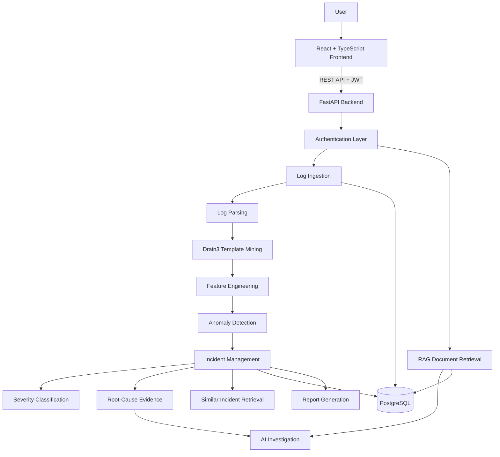

<div align="center">

# 🛰️ IntelliOps AI

### AI-Powered Log Analysis and Incident Investigation Platform

**Transform raw application logs into structured, explainable incident investigations.**

An intelligent incident-triage platform combining Machine Learning, Root-Cause Evidence Analysis, RAG, and AI-powered investigation.

<br>


[Features](#-key-features) ·
[Architecture](#-system-architecture) ·
[Tech Stack](#-technology-stack) ·
[Quick Start](#-getting-started) ·
[Testing](#-testing) ·
[Security](#-security)

</div>

---

## 📌 Project Overview

**IntelliOps AI** is an AI-powered log analysis and incident investigation platform designed to help engineers identify abnormal system behaviour and investigate potential causes of application failures.

During a system failure, engineers often need to examine thousands of log entries, identify unusual patterns, determine incident severity, investigate affected services, and search technical documentation.

IntelliOps AI simplifies this process by combining:

- Automated log parsing and template extraction.
- Machine-learning-based anomaly detection.
- Intelligent incident grouping and severity classification.
- Evidence-based root-cause investigation.
- Similar incident retrieval.
- Retrieval-Augmented Generation (RAG).
- Optional AI-powered investigation.
- Automated incident report generation.

**The main objective is to reduce manual log investigation effort and provide engineers with structured evidence for troubleshooting.**

> Important: The platform identifies anomalies and potential root causes. An AI-generated suggestion is not automatically considered a confirmed root cause.

---

## 🎯 Problem Statement

Traditional log investigation can be time-consuming because engineers must:

- Search through large volumes of application logs.
- Identify abnormal patterns manually.
- Find the earliest affected service.
- Determine incident severity.
- Compare current incidents with historical incidents.
- Search technical documentation for solutions.
- Prepare incident investigation reports.

IntelliOps AI brings these activities together in a single platform.

---

## ✨ Key Features

### 1. Log Management and Parsing

- Upload application log files.
- Validate uploaded files.
- Parse multiple log formats.
- Extract timestamps, log levels, services, and messages.
- Identify recurring log patterns using Drain3.
- Use regex-based parsing as a fallback.
- Support background log processing.

### 2. Machine Learning Anomaly Detection

- Detect unusual log activity across time windows.
- Extract statistical and service-level features.
- Use Isolation Forest for anomaly detection.
- Use Local Outlier Factor as a comparison model.
- Provide a statistical baseline when trained models are unavailable.
- Display anomaly scores and contributing information.

### 3. Intelligent Incident Management

- Group related anomalous windows into incidents.
- Generate stable incident fingerprints.
- Prevent duplicate incident creation during re-analysis.
- Track incident status and lifecycle.
- Maintain incident timelines.
- Add investigation notes.
- Retrieve related historical incidents.

### 4. Explainable Severity Classification

Classify incidents into four severity levels:

| Severity | Description |
|---|---|
| P1 | Critical |
| P2 | High |
| P3 | Medium |
| P4 | Low |

Severity decisions include rule-based explanations rather than relying only on an unexplained priority score.

### 5. Root-Cause Evidence Analysis

The platform identifies potential investigation leads using:

- Earliest-failing service.
- Newly appearing error patterns.
- Changes in error frequency.
- Missing or disappeared log templates.
- Abnormal service activity.

These signals help engineers investigate incidents but do not independently prove causation.

### 6. Similar Incident Retrieval

- Retrieve similar historical incidents.
- Compare shared services and log patterns.
- Use embeddings and vector-based retrieval.
- Support FAISS or exact NumPy-based retrieval.

### 7. AI-Powered Investigation

- Optional Gemini integration.
- Evidence-grounded investigation summaries.
- Structured AI-generated findings.
- Evidence reference validation.
- AI provider error handling.
- Human review of investigation conclusions.

### 8. RAG-Based Runbook Assistant

- Upload PDF, TXT, and Markdown documents.
- Extract and divide document content into chunks.
- Generate embeddings for retrieval.
- Search relevant documentation.
- Generate answers using retrieved context.
- Provide document, page, and chunk citations.
- Handle questions when sufficient documentation is unavailable.

### 9. Reports and Audit Logging

- Generate PDF reports.
- Export CSV reports.
- Generate JSON reports.
- Maintain incident investigation records.
- Record important user activities.
- Track incident status and severity changes.

---

## 🏗️ System Architecture



### Application Workflow

```text
       Application Logs
              |
              v
         Log Upload
              |
              v
         Log Parsing
              |
              v
       Template Mining
              |
              v
      Feature Engineering
              |
              v
      Anomaly Detection
              |
              v
      Incident Grouping
              |
              v
    Severity Classification
              |
              v
    Root-Cause Evidence
              |
              v
      AI Investigation
              |
              v
       Report Generation
```

For more information, see [System Architecture](docs/SYSTEM_ARCHITECTURE.md).

---

## 🧠 Machine Learning

IntelliOps AI uses unsupervised machine learning techniques to identify unusual patterns in application logs.

### Feature Engineering

The system extracts features from time-based log windows, including:

- Log-level counts and ratios.
- Service-level log volume.
- Unique and repeated log templates.
- Changes in error frequency.
- Time between errors.
- Abnormal activity across services.

The feature pipeline also includes tests to check temporal causality.

### Algorithms

| Algorithm | Purpose |
|---|---|
| Robust Statistical Baseline | Fallback anomaly detection |
| Isolation Forest | Primary unsupervised anomaly detector |
| Local Outlier Factor | Comparison anomaly detection model |

### Model Evaluation

The evaluation pipeline supports:

- Precision
- Recall
- F1-score
- PR-AUC
- False-positive rate
- Confusion matrix

### Synthetic Evaluation Results

| Metric | Isolation Forest | Local Outlier Factor |
|---|---:|---:|
| Precision | 0.759 | 0.486 |
| Recall | 0.846 | 0.692 |
| F1-score | 0.800 | 0.571 |
| False-positive rate | 0.012 | 0.033 |
| PR-AUC | 0.823 | 0.730 |

**Evaluation note:** These results were obtained using generated synthetic data. They validate the evaluation pipeline but do not establish real-world model accuracy.

Evaluation using the LogHub/HDFS dataset remains outstanding.

See [ML Methodology](docs/ML_METHODOLOGY.md).

---

## 🤖 AI and RAG Integration

IntelliOps AI combines traditional machine learning with Generative AI.

### AI Investigation

The optional Gemini integration can analyze available incident evidence and generate structured investigation summaries.

The system validates investigation output against available evidence and treats AI-generated conclusions as unconfirmed suggestions.

### RAG Assistant

The RAG pipeline allows engineers to ask questions about uploaded technical documentation.

**Workflow:**

```text
Document Upload
      |
      v
Document Validation
      |
      v
Text Extraction
      |
      v
Text Chunking
      |
      v
Embedding Generation
      |
      v
Vector Retrieval
      |
      v
Relevant Context
      |
      v
AI Answer Generation
      |
      v
Citation Validation
      |
      v
Answer with Sources
```

The assistant can return relevant document excerpts when an AI provider is unavailable. It also handles questions that cannot be answered using the available documentation.

See [RAG Architecture](docs/RAG_ARCHITECTURE.md).

---

## 🛠️ Technology Stack

| Category | Technologies |
|---|---|
| Programming Language | Python, TypeScript, JavaScript |
| Backend | FastAPI, Pydantic |
| Frontend | React, TypeScript, Vite |
| Styling | Tailwind CSS |
| Database | PostgreSQL, SQLAlchemy |
| Database Migrations | Alembic |
| Machine Learning | NumPy, pandas, scikit-learn |
| Log Processing | Drain3, Regex |
| Anomaly Detection | Isolation Forest, Local Outlier Factor |
| Embeddings & Retrieval | Sentence Transformers, FAISS, NumPy |
| Generative AI | Google Gemini API |
| RAG | Document Chunking, Embeddings, Vector Retrieval |
| Data Visualization | Recharts |
| Authentication | JWT, bcrypt |
| Testing | pytest, HTTPX, Vitest, React Testing Library, Playwright |
| DevOps | Docker, Docker Compose, GitHub Actions |

---

## 🧪 Testing and Verification

The following checks have been successfully executed on the current project version.

| Testing Layer | Result |
|---|---:|
| Backend Tests | **275 Passed** |
| Frontend Tests | **36 Passed** |
| Playwright E2E Tests | **2 Passed** |
| Frontend Lint | **Passed** |
| Frontend Production Build | **Passed** |

### End-to-End Test Coverage

The Playwright workflow covers:

1. User registration and login.
2. Dashboard access.
3. Log upload and analysis.
4. Incident creation.
5. Mocked AI investigation.
6. Document upload.
7. RAG queries.
8. Report generation and download.
9. Incident resolution.
10. Logout and protected-page access.

The AI provider is mocked during end-to-end testing. Live Gemini API integration has not yet been verified.

### Run Tests Locally

**Backend:**

```bash
cd backend
pytest -v
```

**Frontend:**

```bash
cd frontend

npm run lint
npm run test
npm run build
npm run e2e
```

---

## 🚀 Getting Started

### Prerequisites

Make sure you have installed:

- Python 3.12
- Node.js
- npm
- PostgreSQL
- Git

Docker and Docker Compose are also available for container-based setup.

### Step 1: Clone the Repository

```bash
git clone https://github.com/manishyadav-aiml/IntelliOps-AI.git

cd IntelliOps-AI
```

### Step 2: Backend Setup

Navigate to the backend directory:

```bash
cd backend
```

Create a Python virtual environment:

```bash
python -m venv .venv
```

Activate the environment.

**Windows PowerShell:**

```powershell
.venv\Scripts\Activate.ps1
```

**Linux / macOS:**

```bash
source .venv/bin/activate
```

Install dependencies:

```bash
pip install -r requirements-dev.txt
```

Create the environment configuration file:

```bash
cp .env.example .env
```

Configure the required database and application settings in `.env`.

Run database migrations:

```bash
alembic upgrade head
```

Start the backend server:

```bash
uvicorn app.main:app --reload --port 8000
```

Backend URL:

```text
http://localhost:8000
```

API documentation:

```text
http://localhost:8000/docs
```

### Step 3: Frontend Setup

Open another terminal and navigate to the frontend directory:

```bash
cd frontend
```

Install dependencies:

```bash
npm install
```

Create the frontend environment file:

```bash
cp .env.example .env
```

Configure the backend API URL according to the frontend environment settings.

Start the frontend:

```bash
npm run dev
```

Open the local URL displayed by Vite.

### Step 4: Optional Gemini Configuration

To enable AI-powered investigation, configure the Gemini API key in the backend environment:

```env
GEMINI_API_KEY=your_api_key
```

The API key must remain on the backend. Never commit secrets or `.env` files to GitHub.

### Step 5: Try Sample Data

Sample logs and documents are available in:

```text
data/
├── sample_logs/
└── sample_documents/
```

---

## 🔐 Security

The application includes the following security controls:

- JWT-based authentication.
- Password hashing using bcrypt.
- Per-user data isolation.
- Pydantic request validation.
- Rate limiting on sensitive operations.
- File upload validation and size restrictions.
- Server-generated filenames.
- Audit logging.
- Server-side AI API key configuration.
- Validation of AI investigation output and retrieved-document citations.

### Known Security Limitations

- JWT logout does not revoke already-issued tokens.
- Frontend tokens are stored in `localStorage`.
- Rate limiting is process-local.
- Uploaded files are not encrypted at rest.
- Prompt-injection protections are mitigations, not guarantees.
- Independent security auditing has not been completed.

See [SECURITY.md](SECURITY.md).

---

## 📁 Project Structure

```text
IntelliOps-AI/
│
├── backend/
│   ├── app/
│   │   ├── api/
│   │   ├── services/
│   │   ├── models/
│   │   ├── parsers/
│   │   ├── ml/
│   │   ├── rag/
│   │   └── ai/
│   │
│   ├── alembic/
│   └── tests/
│
├── frontend/
│   ├── src/
│   │   ├── components/
│   │   ├── pages/
│   │   ├── routes/
│   │   └── tests/
│   │
│   └── e2e/
│
├── data/
│   ├── sample_logs/
│   └── sample_documents/
│
├── scripts/
├── docs/
├── .github/
│
├── docker-compose.yml
├── render.yaml
├── LICENSE
├── SECURITY.md
└── README.md
```

---

## ⚠️ Current Limitations

- Real-world evaluation using LogHub/HDFS has not yet been completed.
- Synthetic evaluation metrics do not establish production accuracy.
- AI investigation findings require human review.
- Background processing is not yet designed for durable multi-instance execution.
- Rate limiting is process-local.
- Team-based access control is not implemented.
- Independent security review and production deployment validation remain outstanding.

---

## 📈 Future Scope

- Real-time incident updates.
- Improved anomaly detection using real-world datasets.
- Scalable background processing.
- Enhanced security and access control.
- Production monitoring and observability.

---

## 📚 Documentation

| Document | Description |
|---|---|
| [System Architecture](docs/SYSTEM_ARCHITECTURE.md) | Application architecture |
| [API Documentation](docs/API_DOCUMENTATION.md) | REST API reference |
| [Database Schema](docs/DATABASE_SCHEMA.md) | Database structure |
| [ML Methodology](docs/ML_METHODOLOGY.md) | Machine learning methodology |
| [RAG Architecture](docs/RAG_ARCHITECTURE.md) | Document retrieval architecture |
| [Security](SECURITY.md) | Security controls and limitations |
| [Known Limitations](docs/KNOWN_LIMITATIONS.md) | Current project limitations |
| [Final Audit Report](docs/FINAL_AUDIT_REPORT.md) | Project verification and audit |

---

## 🎥 Project Demo

| Resource | Status |
|---|---|
| Live Application | Coming Soon |
| Video Walkthrough | Coming Soon |
| Application Screenshots | To Be Added |

---

## 📜 License

This project is licensed under the **MIT License**.

See the [LICENSE](LICENSE) file for details.

---

## 👨‍💻 Author

**Manish Kumar Yadav**

Final-Year B.Tech Student (8th Semester)
Computer Science Engineering — Artificial Intelligence and Machine Learning

**GitHub:** [manishyadav-aiml](https://github.com/manishyadav-aiml)

**LinkedIn:** [Manish Kumar Yadav](https://www.linkedin.com/in/manishkumaryadav946)

**Email:** [yadavmanishkumar1566@gmail.com](mailto:yadavmanishkumar1566@gmail.com)

---

<div align="center">

**IntelliOps AI — Making Incident Investigation More Explainable, Structured, and Efficient.**

</div>
