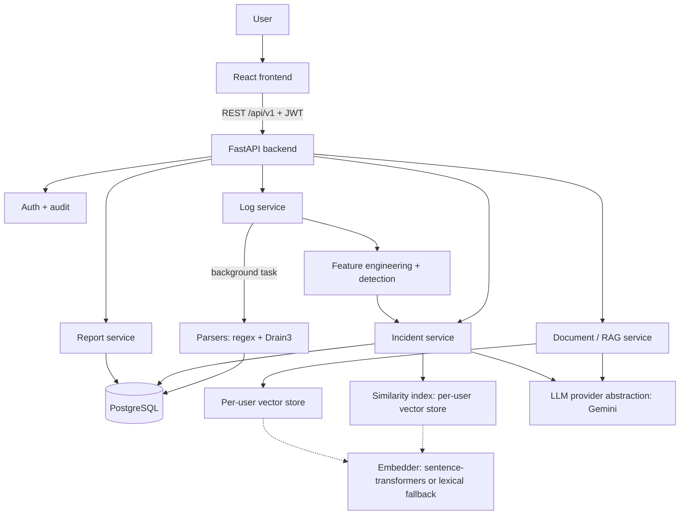

# System architecture

## Layers
`api/` (HTTP, validation, auth dependencies) -> `services/` (use cases, authorization by user id) -> `repositories/` and SQLAlchemy
models. Pure, dependency-light modules hold the algorithms and are unit-tested without a database: `parsers/`, `ml/`, `rag/`,
`ai/`, `services/{incident_logic,similarity,report_builder,dashboard_logic}.py`.

## Request flows
**Upload -> parse:** `POST /logs/upload` streams the file to disk with validation, stores a `PENDING` row and returns 202. A
background task atomically claims it (`PENDING -> PROCESSING`), runs two passes (learn templates, then insert rows in batches)
and ends `COMPLETED` or `FAILED`.

**Analyze -> incident:** `POST /logs/{id}/analyze` builds window features, scores windows (trained model + baseline safeguard, or
baseline alone), stores every window, groups anomalous windows into episodes, then creates or merges incidents using a stable
fingerprint and time-overlap check, and refreshes the per-user similarity index.

**Investigate:** evidence (linked error logs, templates, anomaly summary, severity, similar incidents, retrieved runbook chunks,
human notes) is numbered E1..En, sent to the LLM inside delimiters, and the structured answer is validated before storage.

**RAG:** upload -> validate -> extract text/pages -> chunk -> embed -> per-user vector store; query -> retrieve (owner-filtered)
-> grounded generation -> citations restricted to retrieved chunks. See [RAG_ARCHITECTURE.md](RAG_ARCHITECTURE.md).

## Background work
FastAPI `BackgroundTasks` with compare-and-set status transitions (no duplicate runs, retry for `FAILED`). Celery/Redis is **not
implemented** (not needed at this scale); see [KNOWN_LIMITATIONS.md](KNOWN_LIMITATIONS.md).
